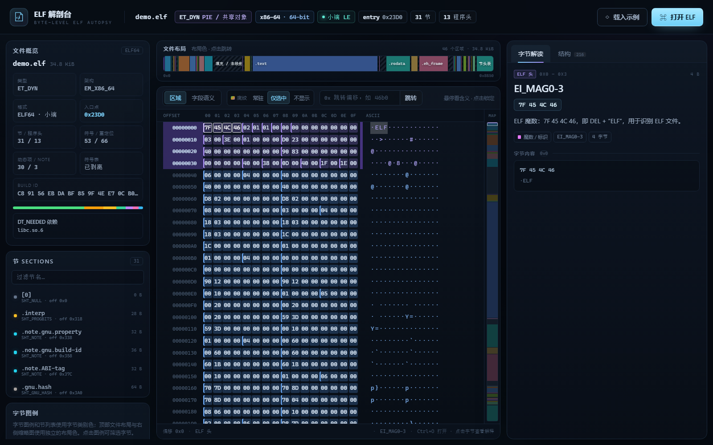

# ELF 解剖台 · ELF Autopsy

一个纯前端的 ELF 文件可视化查看工具。把 ELF 摊开在十六进制视图里，用颜色标注每个字节属于哪个结构、字段、节或符号，并随时查看它的含义。



## 快速开始

### 方式一：直接双击（离线可用）

双击 `index.html`，把任意 ELF 文件拖进页面，或点击“打开 ELF”。

内置示例通过“载入示例”载入（示例已内嵌在 `js/demo.js`，不依赖网络）。

### 方式二：本地静态服务器（推荐）

```powershell
cd elf-viz
python -m http.server 8765
```

然后打开：

- <http://127.0.0.1:8765/> — 空白页，可打开自己的文件
- <http://127.0.0.1:8765/index.html?auto=samples/demo.elf> — 自动载入 64 位示例
- <http://127.0.0.1:8765/index.html?auto=samples/demo32.elf> — 自动载入 32 位示例
- <http://127.0.0.1:8765/index.html?demo=1> — 载入内嵌示例（file:// 下也可用）

不需要任何后端、数据库或第三方前端依赖。

## 功能

### 字节级十六进制视图

- 16 字节/行，带文件偏移与 ASCII 列
- 每个字节按结构/区域着色，字段起点有分界线
- 悬停浮层显示：字段名、值、中文解释、所在节、字节范围
- 点击锁定字节，右侧显示完整解读
- 大文件使用虚拟滚动，只渲染可视行
- 支持偏移跳转（输入十六进制，如 `46b0`）
- 选中字节时自动显示它所属布局区域的 Offset 整行背景和右侧竖带（不改变字节颜色）
- “底纹”三相开关：**常驻显示 / 仅选中 / 不显示**，默认“仅选中”
  - 常驻显示：所有区域都显示
  - 仅选中：只显示当前选中字节所属区域
  - 不显示：不显示区域底纹（点击布局条时也不会点亮）
- Offset 栏使用连续整行背景色，多行同区域会连成一片；字节右侧空白区有同色连续竖带
- 右侧竖向 minimap：始终显示布局色，并标出当前十六进制视口的位置；整体低透明度显示，当前选中字节所属区域恢复为全不透明

### 两种着色模式

| 模式 | 说明 |
| --- | --- |
| 区域 | ELF 头、程序头表、节头表、代码、只读数据、符号表、重定位、动态链接、Note、填充等 |
| 字段语义 | 地址、文件偏移、大小、数量、标志、对齐、索引、字符串、机器码、填充等 |

点击左下图例可以只高亮某一类字节，其他字节自动变暗；再次点击或点“清除筛选”恢复。

顶部“文件布局”、右侧 minimap 和十六进制的“区域底纹”共用一套独立的布局色；这套颜色与字节类别色分开，每个节/表/填充区有自己的颜色。选中任意字节时，它所属的布局区域会自动以低透明度整行 Offset 背景 + 右侧竖带显示，均不叠加到字节背景上；同时 minimap 中对应区块会恢复为全不透明，其余区块保持更低的整体透明度。“底纹”三相开关默认“仅选中”：可选常驻显示 / 仅选中 / 不显示。点击顶部布局条或 minimap 时，目标区域会临时点亮这些区域背景（“不显示”模式下除外）。

### 结构面板

右侧“结构”页签按顺序列出：

- ELF 头：全部字段及值
- 程序头表：类型、权限、文件/内存范围
- 节头表：名称、类型、地址、偏移、大小
- 符号表：可按名称/类型/所属节过滤，支持跳转到符号内容
- 重定位：类型、目标地址、符号、加数
- 动态链接：`DT_NEEDED`、`DT_SONAME` 等标签及字符串值
- Note：构建 ID、ABI 标签、GNU property 等

点击任意一行即可跳到对应字节并选中。每条符号/重定位/动态项/Note 都提供直达按钮。

### 文件布局

顶部的彩色布局条按文件真实比例绘制所有节、表与对齐填充，使用一套独立的“布局色”（与十六进制字节类别色无关）。悬停查看范围与占比，点击后会跳转到该区域并短暂高亮它的背景色。右侧还有一条竖向的布局缩略图（minimap），颜色始终显示，并带有当前视口指示框。

左侧节列表显示类型、偏移、大小与颜色。点击某个节会**选中整节范围**（大范围用行底色标出，避免逐字节描边干扰阅读），右侧显示节级摘要；再点击十六进制中的任意字节，即可回到字段/符号级解读。`.bss` 等 NOBITS 节会特殊说明“不占文件字节”。

## 支持范围

- ELF32 / ELF64
- 小端 / 大端
- `ET_REL`、`ET_EXEC`、`ET_DYN`（PIE/共享库）、`ET_CORE` 的基本结构
- 扩展节数量（section 0 扩展计数、`SHN_XINDEX`）
- 常见节类型：`PROGBITS`、`SYMTAB`、`DYNSYM`、`STRTAB`、`RELA`、`REL`、`DYNAMIC`、`NOTE`、`NOBITS`、`GNU_HASH`、`VERSYM`、初始化数组等
- 符号、重定位、动态项、Note 的逐条注解
- 字符串表逐字符串注解；代码/数据段按符号切分
- 被截断或损坏的文件会给出警告并尽量渲染

暂不支持：

- 反汇编 / 反编译
- DWARF 行号级源码映射
- 压缩节解压（`SHF_COMPRESSED` 仅显示为数据）
- 符号版本名称（`@GLIBC_x.y`）解析
- PE / Mach-O 等其他格式

## 内置示例

| 文件 | 说明 |
| --- | --- |
| `samples/demo.elf` | x86-64 动态可执行文件，含动态链接、重定位、Note |
| `samples/demo32.elf` | i386 32 位动态可执行文件，含 `SHT_REL` 重定位 |
| `samples/ls.elf` | 更复杂的 x86-64 动态可执行文件，用于回归测试 |
| `samples/rel-main.o` / `rel-sum.o` | x86-64 `ET_REL` 可重定位目标文件，含 `.rela.text` 与节内符号 |

“载入示例”使用内嵌的 `demo.elf` 数据，完全离线可用；也可以直接用 `?demo=1` 启动。

> `?auto=samples/...` 通过 `fetch` 读取文件，因此需要 HTTP 服务；用 `file://` 直接打开时请用“载入示例”、`?demo=1` 或拖入文件。

> 演示二进制来自 Debian coreutils（GPLv3），仅用于界面演示。如要再分发本项目，请替换为你拥有授权的 ELF 样例；解析器与界面代码不依赖该二进制。

## 操作提示

| 操作 | 效果 |
| --- | --- |
| 拖入文件 / `Ctrl+O` | 打开 ELF |
| 悬停字节 | 浮层预览含义 |
| 点击字节 | 选中字段/条目并显示解读 |
| 点击图例 | 筛选该类别 |
| “底纹”三相开关 | 常驻显示 / 仅选中 / 不显示（默认仅选中） |
| 点击布局条 / minimap | 跳转到区域并临时点亮该区域背景 |
| 点击节列表 | 跳转并选中整节 |
| `结构` 页签 | 浏览/搜索所有结构条目 |
| 输入偏移 + Enter | 跳转到十六进制偏移 |
| 点击十六进制区域后滚动 | 浏览大文件 |

## 目录结构

```
elf-viz/
├─ index.html          页面骨架
├─ css/style.css       深色主题与布局
├─ js/elf.js           ELF 解析器 + 字节注解引擎（浏览器/Node 通用）
├─ js/app.js           视图、交互、结构面板
├─ js/demo.js          内嵌示例 ELF（base64）
├─ samples/            示例 ELF
├─ test/parser.test.mjs 解析器测试
├─ tools/cdp-smoke.mjs  无头浏览器 UI 冒烟测试（开发用）
└─ screenshot.png
```

## 开发与测试

解析器不依赖 DOM，可直接用 Node 测试：

```powershell
node test/parser.test.mjs
```

目前覆盖：

- 64 位小端动态 ELF：头、节、符号、重定位、动态项、Note、字节注解全覆盖
- 32 位小端动态 ELF：`SHT_REL`、32 位结构尺寸
- `ET_REL` 可重定位对象：节内符号、`SHT_RELA` 与目标节
- 合成 64 位大端 ELF：字节序与节头解析
- 损坏/截断/非 ELF 输入
- 条目字段定位与重定位类型命名

UI 冒烟测试需要先启动一个带远程调试端口的 Chrome，然后：

```powershell
node tools/cdp-smoke.mjs "http://127.0.0.1:8765/index.html?auto=samples/demo.elf" demo.elf smoke.png
```

## 实现要点

1. `elf.js` 解析 ELF 头、程序头、节头和各数据表，生成一组**有序、无重叠、覆盖整个文件**的字节区间（annotation segment）。
2. 每个区间带有 `kind`（区域色）、`role`（字段语义色）、标题、值、解释和可选的结构引用。
3. `app.js` 用二分查找把偏移映射到区间，按可视窗口渲染十六进制行；悬停/选中时重算高亮。
4. 文件布局条由节、头表和填充区间拼成，保持真实比例。
5. 所有解析、渲染都在浏览器本地完成，不上传文件。
